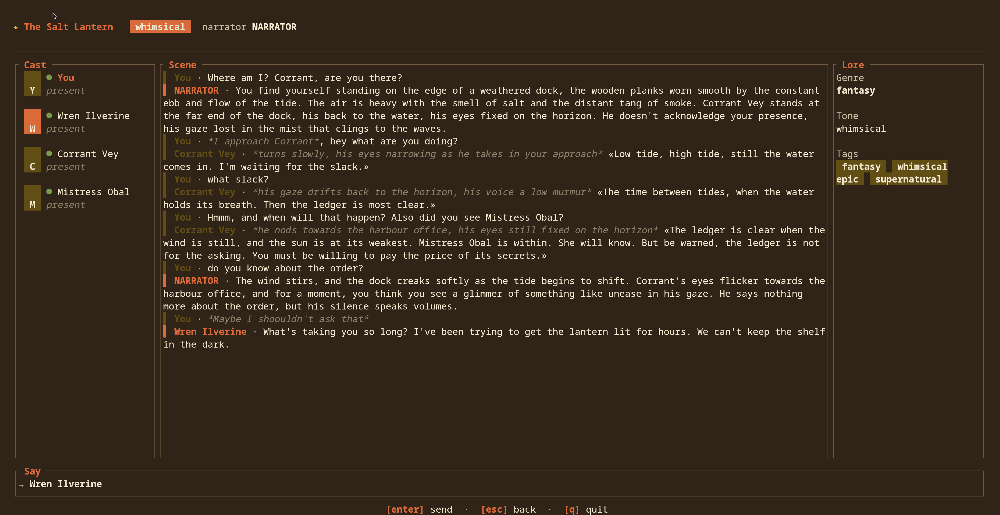

# Living Voices

A local-first roleplay chat app built in **Rust**, with a terminal UI (ratatui) and a desktop UI (Slint). Create characters and a world, then talk with them — with a Narrator that steers events in the background.

## What it does

- **Roleplay chat** — solo or group conversations with AI characters, each with a persistent persona (voice, goals, what they'll reveal) and memory.
- **Narrator** — a third actor that watches the conversation and interrupts with events when the story needs a push ("a guard rounds the corner…").
- **Scene images** — a local image model occasionally renders the current situation, giving a visual heartbeat to the story.
- **Time & world** — a story clock and location changes.

## Preview

#### Incomplete version of the terminal version...


> **NOTE:** Preview for the SLintUI soon

## Architecture

Everything runs locally. The app is a Rust binary with two front-ends over a
shared core, and SQLite for persistence.

```
┌───────────────────────────────┐
│  UI                           │
│  ratatui (TUI) · Slint (GUI)  │
└───────────────┬───────────────┘
                │ state + messages
┌───────────────┴───────────────┐
│  Core (Rust)                  │
│  adventures · characters ·    │
│  messages · memory            │
└──────┬─────────────────┬──────┘
       │                 │
┌──────┴──────┐   ┌──────┴──────┐
│  SQLite     │   │ Local LLMs  │
│ (sqlx)      │   │ (Ollama) +  │
│ adventures, │   │ image model │
│ characters, │   └─────────────┘
│ messages,   │
│ memory      │
└─────────────┘
```

Each model has one job:

| Job | Model | Responsibility |
| --- | --- | --- |
| **Chat** | main LLM | Generates character responses from a character's persona/memory plus the recent conversation. |
| **Narrator** | main LLM | Watches the flow and decides *when* to interrupt with an event. |
| **Memory** | small LLM | Extracts facts into an append-only memory store and compresses older context so the chat LLM only sees clean, prepared context. |
| **Image** | local image model | Generates character portraits / scene snapshots. |

## Getting started

### Prerequisites
- Rust (stable)
- `just` command line for running tasks
- `python 3.12` to setup comfy for image/audio/video generation (newer versions might break some audio models)

### Install test coverage dependencies
```bash
just dev-requirements
```

### Provision the text engine (llama.cpp)
```bash
just provision-llama       # build the engine into ./llama/llama-server
just provision-llama-model # download the GGUF into ./llama/models
```

### Provision ComfyUI (image / video / audio engine)
```bash
just provision-comfy   # pinned ComfyUI v0.44.1 + its own CPython + locked deps into ./comfyui
just image-models-all  # then the models you need: video-model-all, audio-model-all
```

The engine never borrows the system python: `./comfyui/python` is a
python-build-standalone 3.12, the venv is built from it, and every package comes
from `comfy-requirements.lock` (exact pins, each with the sha256 of the wheel it
may install, so installs run `--require-hashes`). First setup downloads ~4 GB of
torch/nvidia wheels; after that the tree is self-contained.

`just provision-comfy-bundle` produces what the release ships, and nothing else:
`provision/comfyui-v0.44.1.tar.zst` (checkout + interpreter + hashed lock, 45 MB,
no `.git`) plus its `.sha256`. No venv and no models go in the bundle; the user's
first run builds the venv from the lock, and `comfyui/.comfy-source` records the
commit the tree came from.

### Execute the App
```bash
just run-debug
```

1. Create a character (name and short description → persona), or load one from a world.
2. Start a conversation — solo, or a group scene.
3. Talk using standard TTRPG message formatting:

| Write | Means | Who sees it |
| --- | --- | --- |
| `"spoken words"` | speech | everyone present |
| `*physical action*` | action (third person, present tense) | everyone present |
| `((private thought))` | thought | no one |
| `(whisper to <name>) "..."` | whisper | only that character |

## Advanced Steps

### Load Comfy UI 
```shell
just comfy-up
# or
COMFY_EXTRA=--lowvram just comfy-up
```

### Load image models
```shell
just image-models-all
```

### Load video models
```shell
just video-model-all
```

### Load Audio models
```shell
just audio-model-all
```

## Non-goals

No long-form novel editing, no RPG rules engine, no cloud dependency. The chat is the final goal, and it runs on your machine only.
Maybe later, mobile support, but no plans.

## AI usage in this project

No vibecoding, any bug this project has, it's entirely my fault. AI is used deliberately for:

- Getting unstuck on specific implementations (still learning Rust)
- Troubleshooting (tons of UI wiring and state management on both SLintUI and RatatUI)
- Writing/Improving tests
- UI layouts (I like SLint and RatatUI, but damn I fell like a trainee once again when coding on them)
- Boilerplate (specially AI integrations)

## Status

Early stage with some [`docs`](docs/) available.