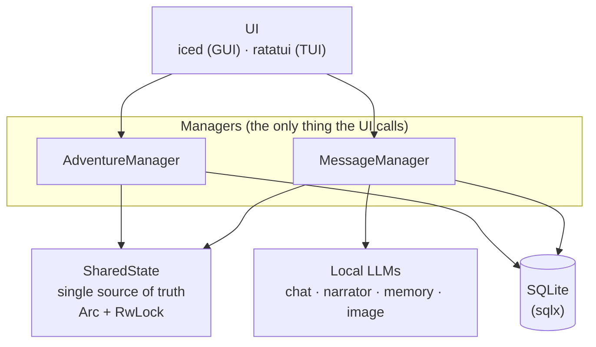
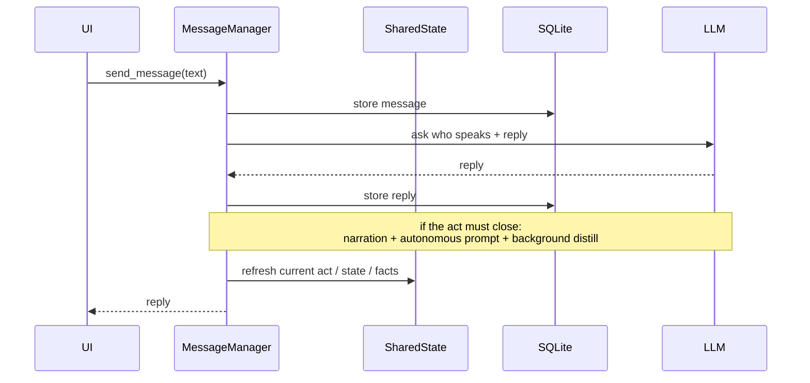

# Application Flow

High-level map of how the app is wired. Read this first.

## How a turn flows

## Notes

- The UI calls **only** the managers. Managers are the one layer exposed as modules to the UI.
- Managers own the `SharedState` behind an `Arc` + `RwLock`: one source of truth, many readers, one writer at a time.
